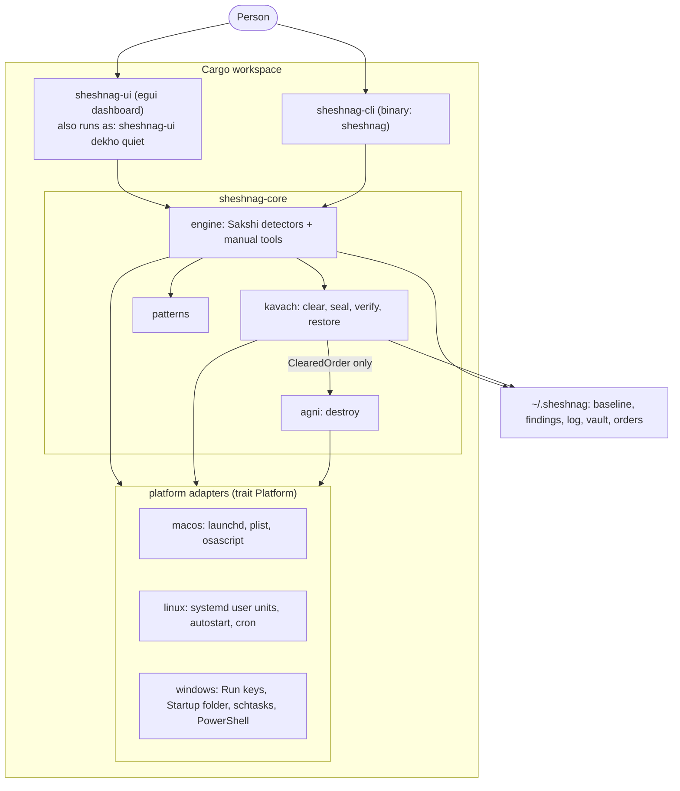
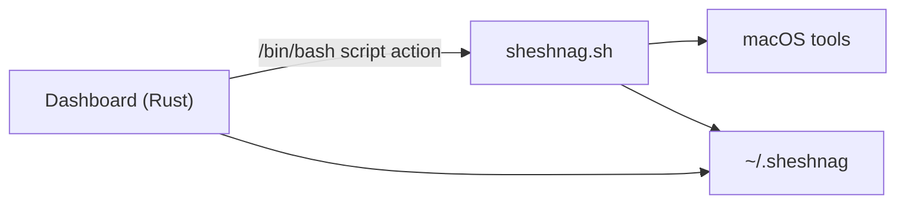
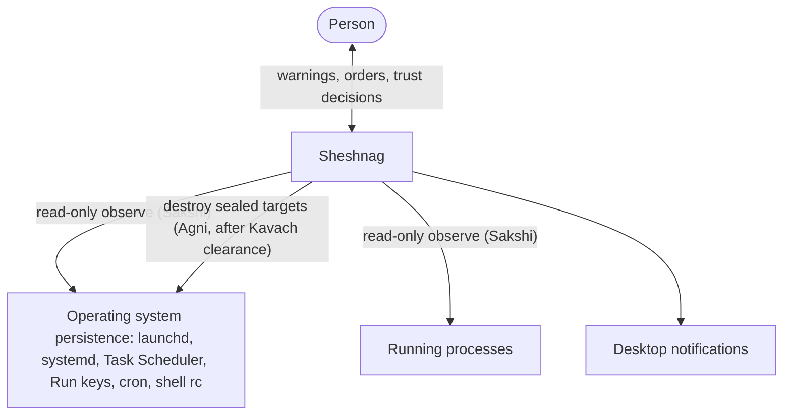
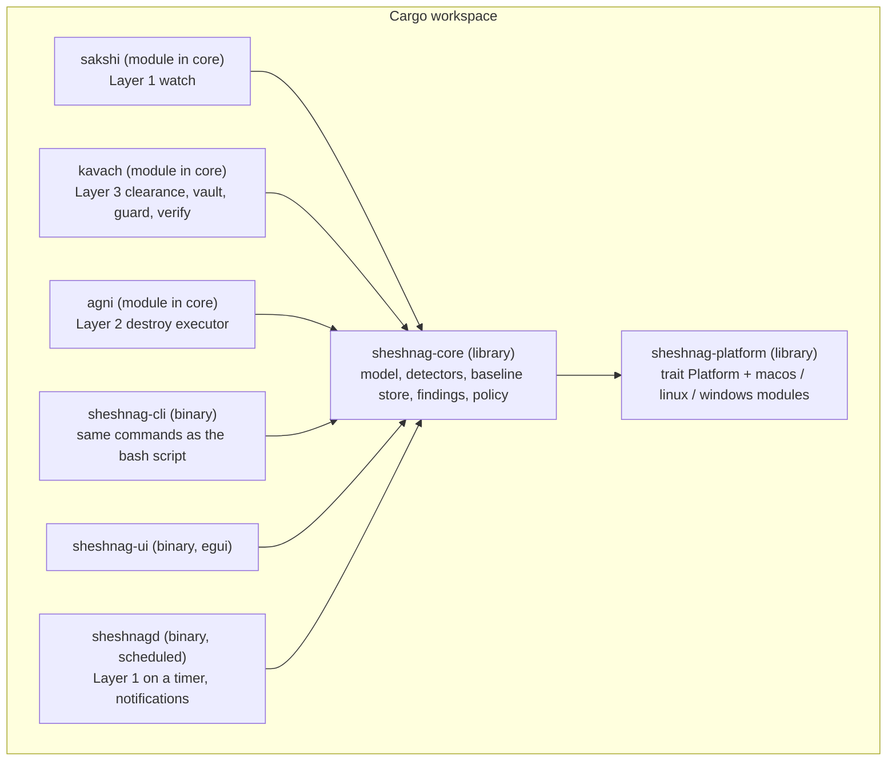
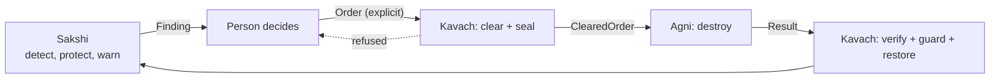
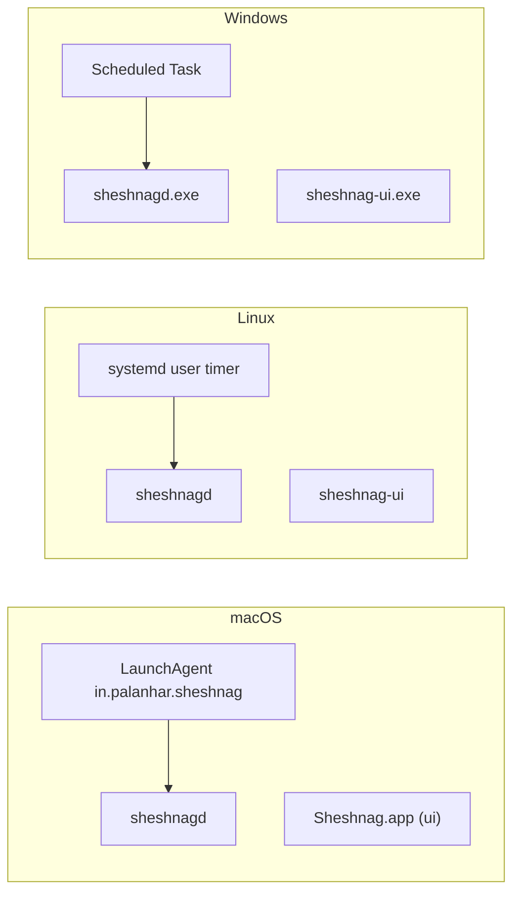

# 03 — Architecture

| | |
| --- | --- |
| Status | Draft for owner review |
| Diagrams | Mermaid, rendered by GitHub and the VS Code Markdown preview. Detailed behaviour diagrams are in `04-design-diagrams.md`. |

## 1. Current architecture (v1.0.0, as built)

The engine is a Rust library. The dashboard, the command-line tool and the scheduled monitor all call it.

What matters about this shape:

- **Agni cannot run without Kavach.** Agni accepts only a `ClearedOrder`, whose fields are private, so only Kavach can build one. A compile-fail test proves it.
- **Adapters are small.** Detection rules, Kavach and Agni are shared. Each adapter lists startup entries, processes, schedules and login items, and knows how to stop, export, import, remove and kill.
- **Commands go through a `Runner`.** Tests replace it with canned output, which is how Linux and Windows are tested on a Mac.
- **One state folder everywhere:** `~/.sheshnag` (`%USERPROFILE%\.sheshnag` on Windows), in the same layout the original script used.
- **The scheduled monitor runs the same program** with `dekho quiet`: a LaunchAgent on macOS, a systemd user timer (or a cron line without systemd) on Linux, a Scheduled Task on Windows.
- **The legacy bash script** (`Src/sheshnag.sh`) is no longer used by the app. It stays as the behavioural reference for the test suite.

### Previous shape (bash engine)

## 2. Target architecture (v2.0)

### 2.1 System context

No network arrow exists on purpose. See requirement `FR-A-05` and non-goal "no action against remote systems".

### 2.2 Containers

Design rules:

1. **Detectors are pure.** A detector takes a `Snapshot` and a `Baseline` and returns `Finding`s. It does no I/O. This makes them trivial to unit test.
2. **Platforms are adapters.** Everything that touches the operating system sits behind `trait Platform`.
3. **Agni cannot be reached except through Kavach.** The type that Agni accepts (`ClearedOrder`) can only be constructed by Kavach. This enforces `FR-A-06` in the compiler.
4. **The UI and CLI are thin.** They call the core library. They do not shell out to scripts.
5. **Agni and Kavach ship behind a cargo feature** (`--features agni`) and are off by default until Phase 5 is complete.

### 2.3 Core components and responsibilities

| Component | Responsibility | Requirements |
| --- | --- | --- |
| `Platform` trait | `list_persistence()`, `list_processes()`, `list_login_items()`, `read_schedule()`, `notify()`, `install_monitor()`, `remove_monitor()`, `stop_process()` | FR-P-02..04 |
| `Snapshot` | Immutable view of the machine at a moment: persistence entries, processes, start-up files, schedule | FR-S-01 |
| `BaselineStore` | Read and write baseline, accepted list, with hash and atomic writes | FR-S-01, FR-S-09 |
| `Detector` | One per rule: new/changed, hidden commands, Apple imitation, miner, CPU, start-up, login | FR-S-02..07 |
| `Finding` | `id, kind, severity, confidence, subject, evidence, first_seen, last_seen, count` | FR-S-14, FR-S-17 |
| `FindingStore` | Current and previous findings, dedupe, "new since last look" | FR-S-08, FR-S-10 |
| `Notifier` | One notification per scan with new findings | FR-S-08 |
| `Trust` | Accepted files and verified-vendor trust | FR-S-09, FR-S-16 |
| `Order` / `ClearedOrder` | The call to Agni, and the same order after Kavach clearance | FR-A-01, FR-A-06 |
| `Kavach::clear` | Deny-list, blast-radius, integrity check, vault seal | FR-K-01..04 |
| `Agni::execute` | Destroy exactly the targets in a `ClearedOrder` | FR-A-02, FR-A-07 |
| `Kavach::verify` / `restore` | Post-run re-scan and restore from the vault | FR-K-06, FR-K-07 |

### 2.4 The protocol as a pipeline

Why Kavach sits on both sides of Agni: the RA document says Kavach exists to protect the person from Agni's own fire. Clearance and sealing before, verification and restore after, are the two halves of that job.

### 2.5 Data and storage

Per-user state folder `~/.sheshnag/` (Linux: `$XDG_STATE_HOME/sheshnag`, Windows: `%LOCALAPPDATA%\Sheshnag`).

| Path | Content | Written by |
| --- | --- | --- |
| `baseline/agents`, `rc`, `cron`, `login`, `when` | Baseline snapshots | Sakshi |
| `baseline/accepted` | Trusted files with hash | Sakshi |
| `findings.now`, `findings.prev` | Latest and previous findings (v2: JSON lines) | Sakshi |
| `log` | Timestamped activity log | All layers |
| `quarantine/` | Moved plists (Layer 1 manual tool) | Sakshi |
| `vault/` | Sealed copies of Agni targets with metadata | Kavach |
| `orders/` | Order and result records | Kavach, Agni |
| `theme` | `system`, `dark` or `light` | Dashboard |

### 2.6 Deployment

### 2.7 Platform mapping

| Concern | macOS | Linux | Windows |
| --- | --- | --- | --- |
| User persistence | `~/Library/LaunchAgents` | `~/.config/systemd/user`, `~/.config/autostart`, user crontab | `HKCU\...\Run`, Startup folder, user Scheduled Tasks |
| System persistence | `/Library/LaunchAgents`, `/Library/LaunchDaemons` | `/etc/systemd/system`, `/etc/cron.*`, `/etc/xdg/autostart` | `HKLM\...\Run`, services, system Scheduled Tasks |
| Shell start-up | `.zshrc`, `.zprofile`, ... | `.bashrc`, `.profile`, `.zshrc` | PowerShell profiles |
| Login items | System Events | XDG autostart | Startup folder and Run keys |
| Scheduler | launchd | systemd user timer, cron | Task Scheduler |
| Notifications | `osascript` or native | `notify-send` / D-Bus | Toast |
| Vendor trust | `codesign` team ID | package manager ownership, distro signatures | Authenticode publisher |

## 3. Architecture decisions

| ID | Decision | Status | Reasoning |
| --- | --- | --- | --- |
| ADR-1 | Move the engine from bash to a Rust library. | **Done** | Needed for cross-platform, type safety and unit tests. Required to honour the RA document's "Core: Rust". |
| ADR-2 | Keep the bash script and the CLI contract as the behavioural oracle until parity is proven. | **Done**, the gtest suite passes against both engines | The gtest suite runs against either engine, so the port is checked rather than trusted. |
| ADR-3 | Agni is reachable only through Kavach, enforced by types. | **Done** | Implements the RA document's "Kavach protects from Agni". |
| ADR-4 | Agni acts only on local artifacts and never opens a network connection. | **Done** | Avoids legal and safety risk of hack-back. See decision D-7. |
| ADR-5 | No automatic destruction. | **Done**, an order needs a person | Measured false-positive rate is not yet acceptable. See `01-gap-analysis.md` Q-3. |
| ADR-6 | Seal before destroy. | **Done** | Makes "no second-guessing" safe: Agni stays blunt, recovery is possible. |
| ADR-7 | Stay on egui/eframe. | **Accepted** | Already in use and cross-platform. See decision D-5. |
| ADR-8 | Use `SHESHNAG_AGENT_DIRS` as a test seam. | Accepted. The Rust core takes directories as constructor arguments. Only the program's own startup code reads the variable, and only on macOS. | Lets tests run without reading real system folders. Defaults are unchanged. In the Rust core the same seam becomes a constructor argument, not an environment variable (NFR-SEC-02). |
| ADR-9 | A single per-user daemon (`sheshnagd`) replaces the "run the script every 10 minutes" model. | Proposed, optional | Allows shared state with the UI. The scheduled one-shot model remains a valid fallback. |

## 4. Threat model summary (for Kavach)

To be expanded in Phase 4. Starting points:

| Threat | Example | Control |
| --- | --- | --- |
| False positive destroyed | Adobe or Microsoft agent flagged because of `/tmp/` | FR-K-01 deny-list, FR-K-02 vault, FR-S-16 vendor trust, user-confirmed orders |
| Lure | Attacker names a malicious plist so that its path or label points at something valuable | FR-K-08, FR-K-01 |
| Reflection | Payload runs a destructive action when Agni touches it | FR-K-05 least privilege, no network, FR-K-03 blast radius |
| Re-arming | Persistence that restores itself after deletion | FR-K-06 post-run verify |
| Tampering | Attacker edits Sheshnag's script or state | FR-K-04 integrity check |
| Evidence loss | Destroyed artifact needed for investigation | FR-K-02 vault |

### Decisions made during implementation

| ID | Decision | Reasoning |
| --- | --- | --- |
| ADR-10 | One state folder, `~/.sheshnag`, on every platform. | Keeps the layout the original script used, so an existing baseline keeps working. |
| ADR-11 | The dashboard binary doubles as the command line (`sheshnag-ui dekho quiet`). | The scheduled monitor needs a program to run, and the macOS app bundle ships only one binary. |
| ADR-12 | An order may only name targets that a fresh scan flags right now. | Blocks stale lists and crafted lures. Kavach re-scans itself and never trusts the order's own description. |
| ADR-13 | Agni acts only on user-scope entries. | A person cannot safely undo machine-wide changes, and those need administrator rights. |
| ADR-14 | Commands are run through a `Runner` trait. | Lets Linux and Windows adapters be tested on any machine with canned output. |
| ADR-15 | Match detection patterns against one plain command string. | Fixes SHE-D-001 and SHE-D-002, which came from matching the JSON form. |
