# 04 — Design Diagrams

Behavioural and structural diagrams that complement `03-architecture.md`. All are Mermaid.
"Today" means built. "Target" means proposed.

**Update 2026-10-16:** the scan engine is now the Rust `sheshnag-core` library instead of the bash script, and it reproduces the flows below (the dashboard calls the library directly, and the scheduled monitor runs `sheshnag-ui dekho quiet`). The Agni with Kavach sequence, the finding life cycle, the Agni arming states and the core class model are **implemented**. One difference: the circuit breaker does not need a manual reset, it clears itself after an hour.

## 1. Use cases

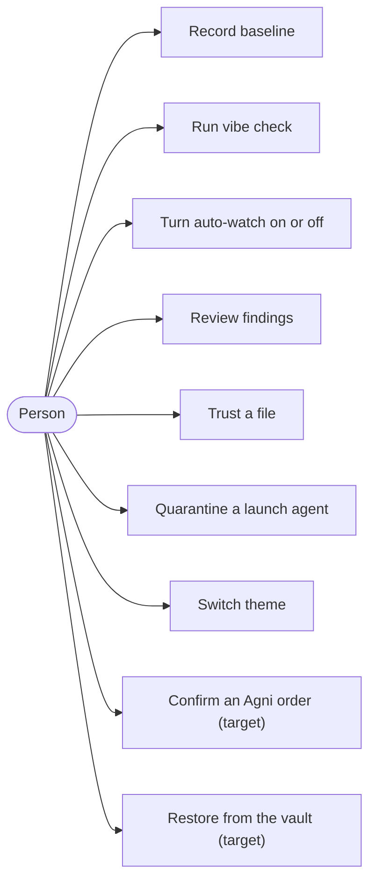

## 2. Sequence — "Run vibe check" (today)

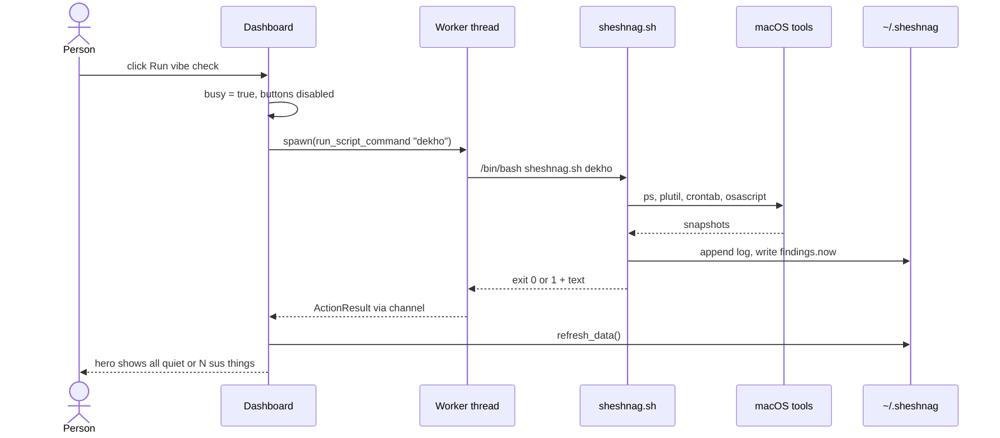

## 3. Sequence — scheduled monitoring (today)

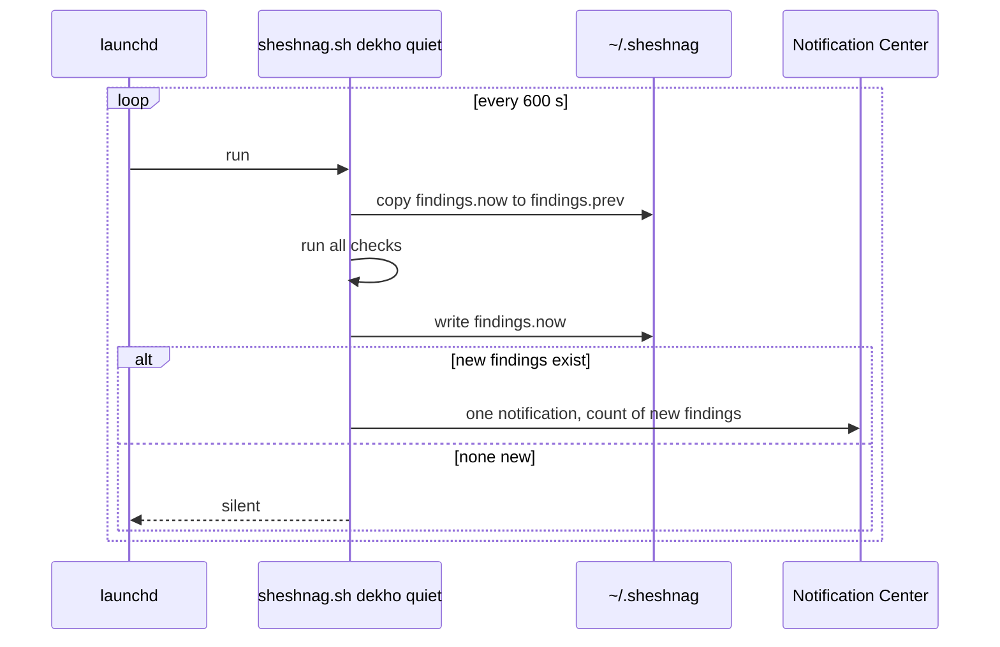

## 4. Sequence — Agni order with Kavach (target)

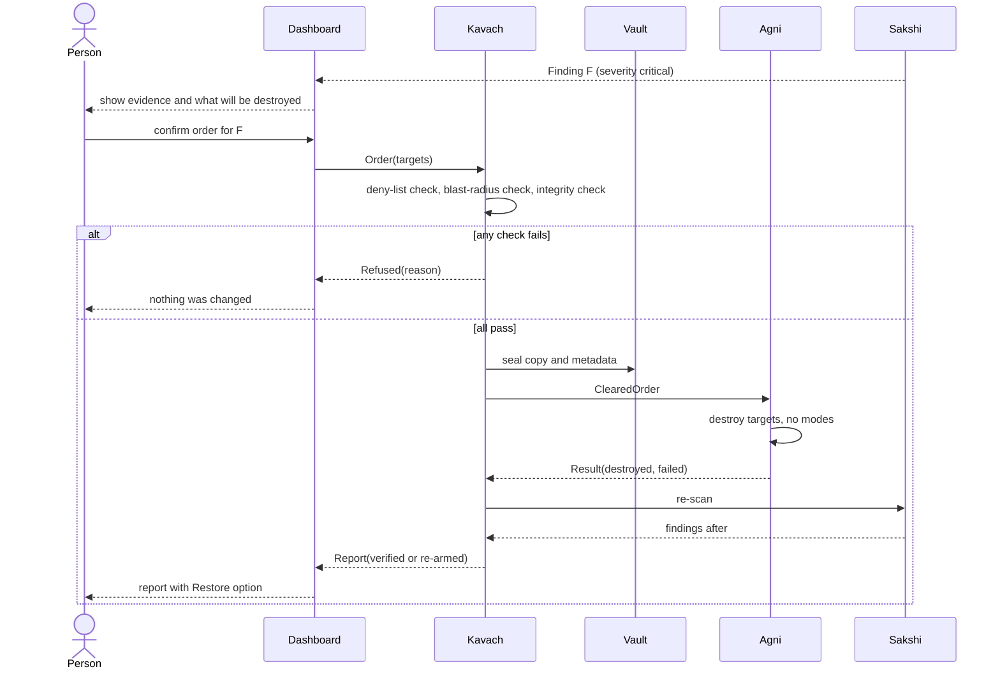

## 5. State machine — dashboard mood (today)

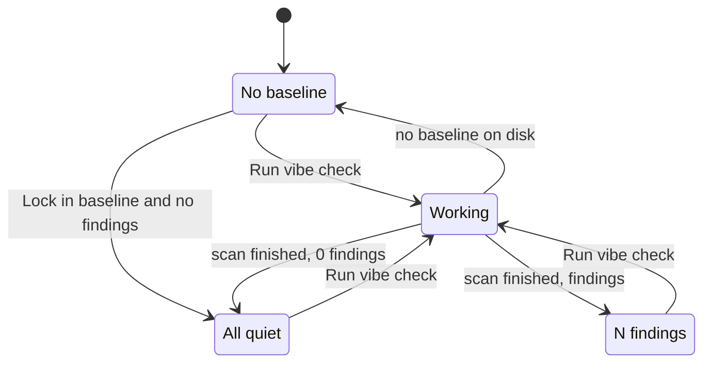

## 6. State machine — a finding's life (target)

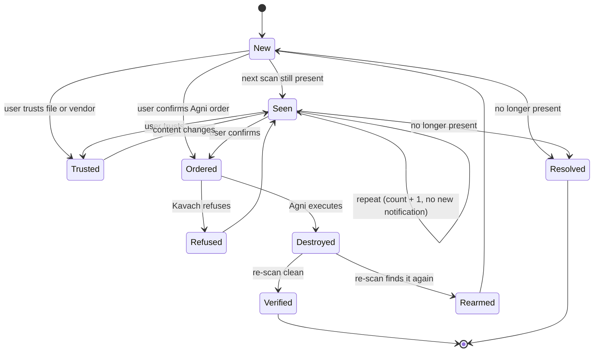

## 7. State machine — Agni arming (target)

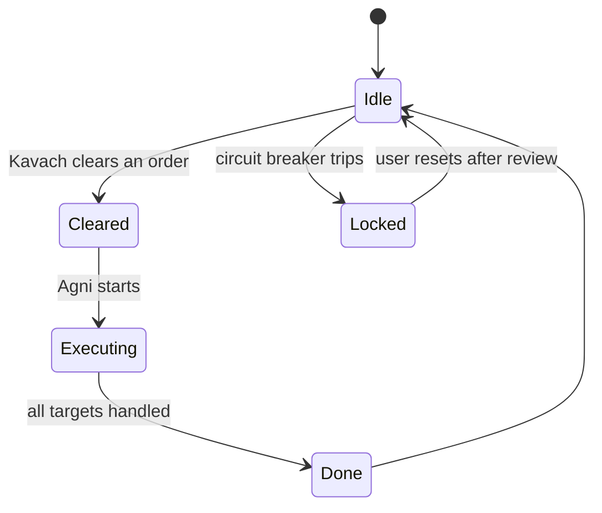

## 8. Class diagram — core model (target)

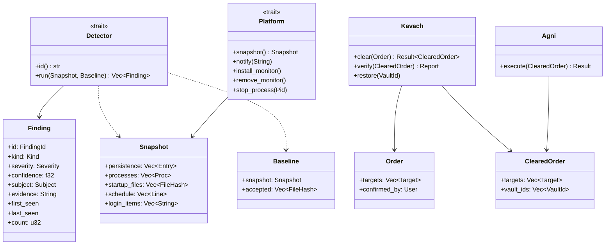

## 9. Detection flow — one scan (today)

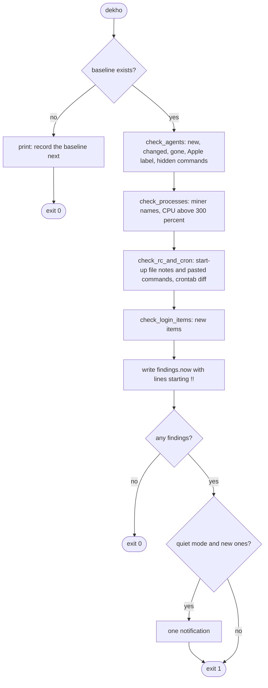

## 10. Data model — state files

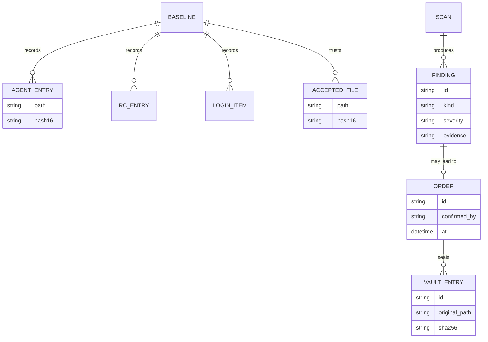

## 11. Dashboard layout (today)

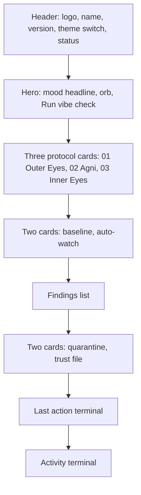
