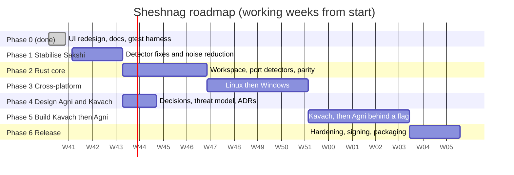

# 05 — Action Plan

| | |
| --- | --- |
| Inputs | `01-gap-analysis.md`, `02-requirements.md`, `03-architecture.md` |
| Estimates | Ideal working days for one engineer, with a 30 percent buffer. They are planning estimates, not commitments. |
| Order | Stabilise what exists, move it to Rust, go cross-platform, then design and build Kavach and Agni. |
| Progress | See section 0 |

## 0. Progress (2026-10-16)

| Phase | State |
| --- | --- |
| 0 Foundations | **Done** |
| 1 Stabilise Sakshi | **Partly done.** A-1.1 (the two detection bugs) and A-1.4 (quarantine without pattern kills) are fixed in the Rust engine. A-1.7 (names) is done in the dashboard. A-1.2 vendor trust, A-1.3 de-duplication, A-1.5 JSON output, A-1.6 and A-1.9 are open. |
| 2 Rust core | **Done.** Workspace, platform trait, detectors, stores, CLI, and the dashboard calls the library. The gtest suite passes against the Rust CLI (A-2.7). The bash script is legacy (A-2.9). |
| 3 Cross-platform | **Implemented, not verified on real machines.** Linux and Windows adapters, schedulers, and unit tests with fakes exist. The workspace compiles for both targets. Still to do: run on real Linux and Windows, CI matrix (written, not yet run), per-platform vendor trust (A-3.7). |
| 4 Design Agni and Kavach | **Skipped ahead.** The proposed design from `01-gap-analysis.md` section 5 was built directly. The owner decisions D-1 to D-7 and the legal review (A-4.7) are still outstanding, so this is provisional. |
| 5 Build Kavach, then Agni | **Mostly done.** A-5.1 to A-5.8 are built and tested. A-5.4 (integrity of Sheshnag itself) and the OS-level part of A-5.6 (egress blocking) are not. A-5.9 is covered by 18 Rust tests, the property and fault-injection tests (T-32, T-33) are not written. A-5.10 (feature flag) was not done, because Agni needs a person to confirm every order. |
| 6 Release hardening | **Open** except the macOS DMG. |

### What to do next

1. Run the Rust test suite and a manual smoke test on a **real Linux machine** and a **real Windows machine**. Fix what the fakes could not show. Windows process and scheduled-task queries are the likeliest to need changes.
2. Owner decisions D-1 to D-7, then legal review of Agni.
3. Vendor trust (A-1.2) so Adobe and Microsoft findings stop repeating.
4. FR-K-04 and FR-K-05: integrity check of the binary, and blocking network access for Agni where the OS allows.
5. Run the CI workflow once and fix anything it finds.

## 1. Guiding principles

1. **Do not build Agni on a noisy Layer 1.** The false-positive rate from the real log (Q-3) must fall first.
2. **Kavach before Agni.** Agni must not exist without the protections that make it safe.
3. **Tests move with the code.** The gtest suite is the behavioural oracle for the Rust port.
4. **Decisions before design.** Phase 4 does not start until decisions D-1 to D-3 are answered.
5. **Docs change with behaviour** (`NFR-DOC-01`).

## 2. Roadmap

Phase 4 runs in parallel with Phases 2 and 3 because it is design work that needs the owner, not code.

## 3. Phases and tasks

### Phase 0 — Foundations (done)

| ID | Task | Result |
| --- | --- | --- |
| A-0.1 | Redesign the dashboard, add Dark, Light, System themes | Done |
| A-0.2 | Gap analysis, requirements, architecture, design diagrams, test plan | Done (this document set) |
| A-0.3 | gtest acceptance suite against the bash engine, 59 tests | Done |
| A-0.4 | Add test seam `SHESHNAG_AGENT_DIRS` | Done |

### Phase 1 — Stabilise Sakshi on macOS (release v1.1)

Goal: a quiet, trustworthy Layer 1. Exit criteria are in section 4.

| ID | Task | Requirement | Est. | Depends on |
| --- | --- | --- | --- | --- |
| A-1.1 | Fix SHE-D-001 and SHE-D-002: scan the decoded argument list joined by spaces, not JSON. Enable the two disabled tests. | FR-S-03 | 2 d | none |
| A-1.2 | Verified-vendor trust: read the code-signing team ID (`codesign -dv`) and let the user trust a vendor once. Trusting a file also suppresses CHANGED for that file until its content differs from the trusted hash. | FR-S-09, FR-S-16 | 4 d | A-1.1 |
| A-1.3 | Deduplicate repeated findings: log an unchanged finding once per day with a counter. | FR-S-17 | 2 d | none |
| A-1.4 | Make quarantine kill only the agent's own process, using the PID from `launchctl list` and an exact match. Update the test that documents today's behaviour. | FR-S-15, NFR-SAFE-01 | 2 d | none |
| A-1.5 | Add `dekho --json`, one JSON object per finding with ID, kind, severity, evidence. Keep text output and exit codes unchanged. | FR-S-14, FR-S-18, FR-S-13 | 3 d | A-1.1 |
| A-1.6 | Decide how to treat a changed shell start-up file (note or finding) and implement it. | FR-S-06 | 1 d | decision |
| A-1.7 | Align names and paths: Sakshi, Agni, Kavach in the UI and README, one log path, one version number. | FR-U-05, G-3, G-4, G-7 | 2 d | none |
| A-1.8 | Reduce dashboard repaint rate when idle and not busy. | NFR-PERF-02 | 1 d | none |
| A-1.9 | Add the warning text that addresses both the person and the intruder. | FR-S-19 | 1 d | none |
| A-1.10 | Run the gtest suite in CI on macOS for every change. | NFR-MNT-01 | 1 d | none |

Subtotal 19 d. With buffer, 3 working weeks.

### Phase 2 — Rust core (release v1.2)

Goal: the engine is Rust. Behaviour is identical, proven by the same tests.

| ID | Task | Requirement | Est. | Depends on |
| --- | --- | --- | --- | --- |
| A-2.1 | Convert the repository to a Cargo workspace: `sheshnag-core`, `sheshnag-cli`, `sheshnag-ui`. Move `main.rs` into the UI crate. | ADR-1 | 3 d | Phase 1 |
| A-2.2 | Define `Platform`, `Snapshot`, `Baseline`, `Detector`, `Finding`. | NFR-PORT-01 | 3 d | A-2.1 |
| A-2.3 | macOS platform adapter that wraps `launchctl`, `plutil` (or the `plist` crate), `ps`, `crontab`, `osascript`. | FR-P-01 | 4 d | A-2.2 |
| A-2.4 | Port each detector as a pure function with unit tests (`cargo test`). | FR-S-02..07 | 6 d | A-2.2 |
| A-2.5 | `BaselineStore`, `FindingStore`, `Notifier`, `Trust`. | FR-S-01, 08, 09, 10 | 4 d | A-2.2 |
| A-2.6 | `sheshnag-cli` with the same commands and exit codes as the script. | FR-S-13 | 2 d | A-2.4, A-2.5 |
| A-2.7 | Make the gtest harness select the engine: `SHESHNAG_BIN=path` runs the Rust CLI, otherwise the bash script. Run both in CI and require identical results. | ADR-2 | 2 d | A-2.6 |
| A-2.8 | Switch the dashboard to call the core library instead of a shell script. | G-2 | 3 d | A-2.6 |
| A-2.9 | Retire `sheshnag.sh` from the default path. Keep it under `legacy/` for one release. | ADR-1 | 1 d | A-2.7, A-2.8 |

Subtotal 28 d. With buffer, 5 working weeks.

### Phase 3 — Cross-platform (releases v1.3 Linux, v1.4 Windows)

| ID | Task | Requirement | Est. | Depends on |
| --- | --- | --- | --- | --- |
| A-3.1 | Linux adapter: systemd user units, XDG autostart, user crontab, shell rc files, `ps`, `notify-send`. | FR-P-02 | 8 d | Phase 2 |
| A-3.2 | Linux scheduler: systemd user timer replaces the LaunchAgent. | FR-S-11 | 2 d | A-3.1 |
| A-3.3 | Linux tests: run the CLI contract and detector tests in a container. | NFR-PORT-01 | 3 d | A-3.1 |
| A-3.4 | Windows adapter: Run keys, Startup folder, Scheduled Tasks, services (read-only), process list, toast notifications. | FR-P-03 | 10 d | Phase 2 |
| A-3.5 | Windows scheduler and tests. | FR-S-11 | 4 d | A-3.4 |
| A-3.6 | CI matrix on macOS, Linux and Windows. | NFR-PORT-01 | 2 d | A-3.3, A-3.5 |
| A-3.7 | Vendor trust per platform (`codesign`, package ownership, Authenticode). | FR-S-16 | 4 d | A-3.1, A-3.4 |

Subtotal 33 d. With buffer, 6 working weeks. Linux can ship before Windows.

### Phase 4 — Design Agni and Kavach (runs alongside Phases 2 and 3)

| ID | Task | Output | Est. | Depends on |
| --- | --- | --- | --- | --- |
| A-4.1 | Owner answers decisions D-1 to D-7 (`01-gap-analysis.md`). | Signed-off decisions | 1 d owner time | none |
| A-4.2 | Write the Kavach threat model: false positives, lures, reflection, re-arming, tampering. | `docs/08-threat-model.md` | 3 d | A-4.1 |
| A-4.3 | Define the order format, the deny-list policy and the blast-radius numbers. | ADR-10, ADR-11 | 2 d | A-4.2 |
| A-4.4 | Define the vault format and the restore procedure. | ADR-12 | 2 d | A-4.2 |
| A-4.5 | Prototype "dry-run Agni": runs clearance and sealing, prints what it would destroy, destroys nothing. Use it on the real machine for two weeks to measure false positives. | Metrics report | 3 d | A-4.3, A-1.x |
| A-4.6 | Review requirements FR-A and FR-K and promote them from Proposed to Approved. | Updated `02-requirements.md` | 1 d | A-4.5 |
| A-4.7 | Legal review of Agni's scope and of the patent question (D-6). | Written decision | external | A-4.1 |

Subtotal 12 d plus external review.

### Phase 5 — Build Kavach, then Agni (release v2.0)

| ID | Task | Requirement | Est. | Depends on |
| --- | --- | --- | --- | --- |
| A-5.1 | Vault: seal and restore with hashes and metadata. | FR-K-02, FR-K-07 | 4 d | A-4.4 |
| A-5.2 | Deny-list and clearance. | FR-K-01, FR-K-08 | 4 d | A-4.3 |
| A-5.3 | Blast-radius limits and circuit breaker. | FR-K-03 | 3 d | A-5.2 |
| A-5.4 | Integrity check of Sheshnag's own files. | FR-K-04 | 3 d | A-2.x |
| A-5.5 | Order and `ClearedOrder` types, so Agni cannot run without Kavach. | FR-A-01, FR-A-06 | 2 d | A-5.2 |
| A-5.6 | Agni executor per platform: destroy exactly the cleared targets, nothing else. No network. Least privilege. | FR-A-02, 04, 05, 07, FR-K-05 | 6 d | A-5.5 |
| A-5.7 | Post-run verification and report. | FR-K-06 | 3 d | A-5.6 |
| A-5.8 | Dashboard Agni order flow with plain-language summary and Restore. | FR-U-07 | 5 d | A-5.7 |
| A-5.9 | Safety test suite for Agni and Kavach (section 6 of the test plan). | NFR-SAFE-01..03 | 6 d | A-5.6 |
| A-5.10 | Everything behind `--features agni`, default off, until Phase 6 exit criteria pass. | ADR-5 | 1 d | A-5.8 |

Subtotal 37 d. With buffer, 7 working weeks.

### Phase 6 — Release hardening (v2.0)

| ID | Task | Est. |
| --- | --- | --- |
| A-6.1 | Third-party security review of Kavach clearance and Agni execution | external |
| A-6.2 | macOS signing and notarisation, Linux packages, Windows installer | 5 d |
| A-6.3 | Accessibility and contrast check in both themes (`NFR-UX-02`) | 2 d |
| A-6.4 | Performance check (`NFR-PERF-01`, `NFR-PERF-02`) | 2 d |
| A-6.5 | Final documentation pass and changelog | 2 d |
| A-6.6 | Dogfood on real machines for two weeks, with Agni in dry-run | 10 d elapsed |

## 4. Exit criteria per phase

| Phase | Done when |
| --- | --- |
| 1 | All gtest cases pass, the two disabled tests are enabled and pass, and a 7-day run on the owner's Mac produces no repeated findings and no vendor-agent false alarms. |
| 2 | The gtest suite passes against both the bash script and the Rust CLI with identical results. Detector unit tests pass. The dashboard no longer shells out to a script. |
| 3 | CI is green on all three platforms. Each platform has a detector suite and a CLI contract suite. |
| 4 | Decisions D-1 to D-7 are recorded. The threat model is reviewed. Dry-run Agni measured on a real machine. |
| 5 | Every FR-A and FR-K requirement has a passing test. The safety suite passes. Agni cannot be invoked without a `ClearedOrder`. |
| 6 | Independent review has no open high findings. Two weeks of dogfooding without an unrecoverable destruction. |

## 5. Risks

| ID | Risk | Likelihood | Impact | Mitigation |
| --- | --- | --- | --- | --- |
| R-1 | Agni destroys a legitimate component because of a false positive | High if automated | High | ADR-5 no automation, FR-K-01, FR-K-02, dry-run, vendor trust |
| R-2 | Port to Rust changes behaviour | Medium | Medium | Same gtest suite against both engines (A-2.7) |
| R-3 | Windows and Linux persistence is wider than macOS and takes longer | High | Medium | Ship Linux first, scope Windows to read-only observation initially |
| R-4 | Owner decisions D-1 to D-3 are delayed | Medium | High | Phases 1 to 3 do not depend on them |
| R-5 | Test seam used to blind the monitor | Low | High | ADR-8: seam is removed in the Rust core, replaced by constructor arguments |
| R-6 | Legal exposure from destructive features | Low to medium | High | ADR-4 local only, A-4.7 legal review |
| R-7 | Repaint rate causes battery drain | Medium | Low | A-1.8 |
| R-8 | Public release harms patentability | Unknown | Medium | Decide D-6 before open-sourcing |

## 6. Immediate next steps (next two weeks)

1. Owner reviews `01-gap-analysis.md` section 4 and answers D-1 to D-7. Start with D-1, D-2 and D-3.
2. Fix SHE-D-001 and SHE-D-002 (A-1.1) and enable the two disabled tests.
3. Add vendor trust (A-1.2) so the real Adobe and Microsoft findings stop repeating.
4. Wire the gtest suite into CI (A-1.10).
5. Align naming across the UI and README (A-1.7).

## 7. Defect register

| ID | Defect | Test | Planned fix |
| --- | --- | --- | --- |
| SHE-D-001 | Inline interpreter passed as separate arguments is not flagged | `AgentDetectionTest.DISABLED_FlagsInlinePythonPassedAsSeparateArguments` | A-1.1 |
| SHE-D-002 | `/tmp/` is not matched inside `ProgramArguments` because JSON escapes slashes | `AgentDetectionTest.DISABLED_FlagsATmpPathInProgramArguments` | A-1.1 |
| SHE-D-003 | Vendor agents repeatedly flagged | Not yet automated, needs a vendor-signed fixture | A-1.2 |
| SHE-R-003 | Quarantine kills by unanchored pattern | `QuarantineTest.CurrentlyKillsByUnanchoredLabelPattern` (documents today's behaviour) | A-1.4 |
