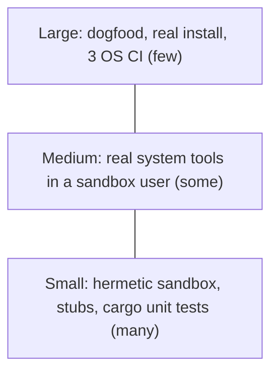

# 06 — Test Plan

| | |
| --- | --- |
| Scope | The Sheshnag detection engine and command-line contract today, plus the planned tests for the Rust core, the dashboard, and Layers 2 and 3 |
| Framework | GoogleTest and GoogleMock (v1.15.2, fetched and pinned by checksum), driven by CMake and CTest. Rust tests use `cargo test`. |
| Location | `qa/gtest/` |
| Status | gtest: 62 tests, 59 pass against the bash script (3 skipped), 61 pass against the Rust CLI (1 skipped). `cargo test`: 63 tests plus 1 compile-fail doctest. All passing. |

## 1. Objectives

1. Prove that each Layer 1 requirement behaves as documented.
2. Protect the behaviour while the engine moves from bash to Rust. The same tests judge both engines.
3. Prove the safety property of Layer 1: it observes and never changes the machine on its own.
4. Define the tests that Agni and Kavach must pass before they ship.

## 2. Why gtest drives a bash script

GoogleTest is a C++ framework and the product is Rust and bash. The suite therefore tests the product **from the outside**: it starts the real program in a sandbox, then checks exit codes, output and files. This is how Google describes large black-box and "medium" tests, and it has two benefits here:

- It tests the real artifact, not a model of it.
- The same tests can later run against the Rust CLI by changing one setting (`SHESHNAG_BIN`, task A-2.7). That makes the Rust port a checked change.

Unit tests for Rust code itself should use `cargo test`, which is the idiomatic tool. They are planned in section 8 and complement the gtest suite. Testing Rust internals from gtest would need a C interface and adds cost without adding value.

## 3. Test strategy and sizes

Sizes follow the Google convention: tests are classified by the resources they need, not by their subject.

| Size | Resources | Time limit | This project |
| --- | --- | --- | --- |
| Small | Single process, no network, no real system state, no sleeping | 1 minute (CTest timeout here: 30 s) | All 59 current tests. Each runs the script in a sandbox with stubbed system commands. |
| Medium | Several processes on one machine, may use real local tools | 5 minutes | Planned: scripts run against real `plutil`, `launchctl` in a throw-away user session. |
| Large | Real machine or several machines | 15 minutes or more | Planned: manual and dogfood runs, install and uninstall on a real Mac, cross-platform CI. |

The distribution should be a pyramid: many small tests, fewer medium, a handful of large.



## 4. Test levels and what covers them

| Level | Target | Tool | Status |
| --- | --- | --- | --- |
| Unit | Rust detectors, parsing, policy | `cargo test` | Planned (Phase 2) |
| Component (black-box) | `sheshnag.sh` / future `sheshnag-cli`: commands, exit codes, files, notifications | gtest | **Done**, 59 tests |
| Integration | Dashboard calling the engine, state files read by the UI | `cargo test` with a fake engine, later UI snapshot tests | Planned |
| Safety | Layer 1 never changes the machine. Agni and Kavach invariants | gtest and `cargo test` | Layer 1 done (`WatchOnlyTest`), Layers 2 and 3 planned |
| Cross-platform | Same suite on Linux and Windows | gtest in CI matrix | Planned (Phase 3) |
| Exploratory and acceptance | Real Mac, real agents | Manual checklist, dogfood | Planned |

## 5. Practices applied (and why)

These follow the guidance Google publishes in *Software Engineering at Google* and the Testing Blog.

| Practice | How it is applied here |
| --- | --- |
| **Hermetic tests** | Each test creates a private temp directory. `HOME`, the agent folders and `PATH` all point inside it. Real `/Library` folders are never read, which is why the `SHESHNAG_AGENT_DIRS` seam exists. |
| **Fakes and stubs at the boundary, not mocks inside** | `launchctl`, `osascript`, `crontab`, `ps` and `pkill` are small recording stubs. Tests assert on observable effects (files, exit codes, recorded calls) rather than on implementation steps. |
| **Test behaviour, not implementation** | Tests name the behaviour: `FlagsANewAgent`, `DoesNotFlagExactlyThreeCores`. They never assert on how the script is structured. |
| **Readable names, one behaviour per test** | Pattern `Suite.Behaviour` with the condition in the name. A failing name should explain the problem without opening the file. |
| **DAMP over DRY** | Each test shows its own setup and expected result. Shared helpers only hide mechanics (making plists, running the script). Logic is kept out of tests. |
| **Arrange, Act, Assert** | Setup, one call to `Run`, then assertions, separated by blank lines. |
| **`ASSERT` for preconditions, `EXPECT` for checks** | A failed precondition (for example baseline creation) stops the test. Checks continue so one run reports all differences. |
| **Deterministic** | No sleeps, no clocks, no network, no randomness in assertions. CTest sets a timeout. Shuffled and repeated runs must pass (`--gtest_shuffle --gtest_repeat=3`). |
| **Independent and order-free** | Every test builds its own fixture in `SetUp` and deletes it in `TearDown`. |
| **Boundary values** | CPU limit has tests at 300, 301 and 450 percent. |
| **Table-driven tests** | `INSTANTIATE_TEST_SUITE_P` covers each hidden-command token with its own readable name. |
| **Known defects are tracked, not hidden** | Failing expectations for open defects are `DISABLED_` with a defect ID in a comment. They are enabled when the fix lands. A disabled test is never deleted silently. |
| **Characterisation tests** | Where current behaviour is questionable (`CurrentlyKillsByUnanchoredLabelPattern`), a test records it so that changing it is a deliberate act. |
| **Fast feedback** | The full small suite runs in about 12 seconds. |
| **Warnings are errors** | The suite compiles with `-Wall -Wextra -Werror`. |
| **Pinned dependencies** | GoogleTest is pinned by version and SHA-256. |
| **Machine-readable results** | `ctest --output-on-failure` and `--gtest_output=xml` for CI. |

## 6. Entry and exit criteria

| | Criteria |
| --- | --- |
| Entry for a change | Requirement exists with an ID. Test cases are written or updated in the same change. |
| Exit for a change | All active tests pass on a clean checkout. No new disabled test without a defect ID. Shuffled repeat run passes. Docs updated. |
| Exit for a release | Phase exit criteria in `05-action-plan.md`, section 4, are met. No open defect of severity high. |

## 7. Requirement traceability

"Planned" means a requirement has no test yet. Those are test tasks, not gaps in intent.

| Requirement | Test suite and cases | Status |
| --- | --- | --- |
| FR-S-01 Baseline | `BaselineTest.*` (6) | Covered |
| FR-S-02 New, changed, removed | `AgentDetectionTest`: `FlagsANewAgent`, `FlagsAChangedAgent`, `ReportsARemovedAgentWithoutRaisingAFinding`, `QuietWhenNothingChangedSinceBaseline`, `WithoutBaselineAsksForOneAndFlagsNothing` | Covered |
| FR-S-03 Hidden commands | `HiddenCommandTest` (8 tokens), `FlagsAProgramKeyThatPointsIntoTmp`, `DoesNotFlagAnOrdinaryProgram`, `IgnoresSheshnagsOwnLaunchAgentLabel...` ; disabled: SHE-D-001, SHE-D-002 | Partly covered, 2 open defects |
| FR-S-04 Apple imitation | `FlagsAnAgentThatImpersonatesAppleWithCapitalA`, `FlagsAnAppleNamedAgentInTheUsersOwnFolder`, `DoesNotFlagAnAppleNamedAgentInTheSystemFolder` | Covered |
| FR-S-05 Miners and CPU | `ProcessDetectionTest.*` (6), boundary at 300 and 301 | Covered |
| FR-S-06 Start-up files and cron | `StartupDetectionTest`: pasted command, benign change, crontab | Covered |
| FR-S-07 Login items | `StartupDetectionTest`: new item, removed item | Covered |
| FR-S-08 Notifications | `NotificationTest`: silent, once only, interactive never notifies | Covered |
| FR-S-09 Trust a file | `TrustFileTest.*` (3), `AcceptedFileIsNotReflaggedUntilItsContentChanges` | Covered, Q-5 not covered |
| FR-S-10 State files | `NotificationTest.WritesOnlyFindingLinesToTheStateFile...`, `CliContractTest.CreatesItsStateFolderOnFirstRun` | Covered |
| FR-S-11 Install and uninstall | `InstallTest.*` (4) | Covered |
| FR-S-12 Quarantine | `QuarantineTest.*` (5) | Covered |
| FR-S-13 CLI contract | `CliContractTest.*` (5) | Covered |
| FR-S-14, 15, 16, 17, 18, 19 | None yet | Planned with Phase 1 |
| NFR-SAFE-01 Watch-only | `WatchOnlyTest.ScanWithFindingsDoesNotMoveDeleteOrKill` | Covered |
| FR-A-*, FR-K-* | See section 9 | Planned with Phase 5 |
| FR-U-* | See section 8 | Planned |
| FR-P-02, FR-P-03 | See section 10 | Planned with Phase 3 |
| NFR-PERF-01, NFR-PERF-02 | See section 8 | Planned |
| NFR-UX-02 | See section 8 | Planned |

## 8. Planned tests, Layer 1 and the dashboard

| ID | Test | Level | Requirement |
| --- | --- | --- | --- |
| T-1 | Enable `DISABLED_` tests when SHE-D-001 and SHE-D-002 are fixed | Component | FR-S-03 |
| T-2 | Vendor-signed agent is not flagged after the vendor is trusted | Medium | FR-S-16 |
| T-3 | An unchanged finding is logged once per day with a count | Component | FR-S-17 |
| T-4 | `dekho --json` output validates against a schema and agrees with the text output | Component | FR-S-18 |
| T-5 | Quarantine stops only the agent's own process, not other processes whose command line contains the label | Component | FR-S-15 |
| T-6 | Trusting a file also suppresses CHANGED until its hash differs | Component | FR-S-09 |
| T-7 | Scan time with 100 generated agents is under 5 seconds | Component | NFR-PERF-01 |
| T-8 | A failing check does not stop later checks | Component | NFR-REL-01 |
| T-9 | Rust unit tests for each detector with table-driven inputs | Unit (`cargo test`) | FR-S-02..07 |
| T-10 | Rust unit test: `Mood` selection from findings and baseline | Unit | FR-U-02 |
| T-11 | Rust unit test: theme preference parse and resolve (system, dark, light) | Unit | FR-U-04 |
| T-12 | Rust unit test: log line parser handles lines with and without a timestamp | Unit | FR-U-01 |
| T-13 | Contrast ratios of text on every card colour meet WCAG AA in Dark and Light | Unit | NFR-UX-02 |
| T-14 | Dashboard idle CPU under 2 percent over a 60 second window | Large, manual | NFR-PERF-02 |
| T-15 | Dashboard never launches a scan or installs monitoring on start | Integration with a fake engine | FR-U-03 |

## 9. Planned tests, Layer 2 (Agni) and Layer 3 (Kavach)

Written before the code (test-first) in Phase 5. These express the safety properties of the design.

| ID | Test | Requirement |
| --- | --- | --- |
| T-20 | Agni refuses an order that Kavach has not cleared. It must not compile for a raw `Order`. | FR-A-06, ADR-3 |
| T-21 | Agni destroys exactly the cleared targets and nothing else, checked by a directory snapshot diff | FR-A-02, FR-A-04 |
| T-22 | Agni opens no network connection (checked with a sandbox that blocks sockets) | FR-A-05 |
| T-23 | Every destroyed target and every failure appears in the log | FR-A-07 |
| T-24 | Kavach refuses a target on the deny-list (operating system path, user documents, Sheshnag's own files) | FR-K-01 |
| T-25 | Kavach refuses a target whose label or path was crafted to resolve into a protected location (symlink, `..`, case tricks) | FR-K-08 |
| T-26 | Kavach seals a copy before Agni runs, and `restore` returns identical bytes and metadata | FR-K-02, FR-K-07 |
| T-27 | Kavach refuses an order above the blast-radius limit | FR-K-03 |
| T-28 | Circuit breaker locks after repeated orders and needs a manual reset | FR-K-03 |
| T-29 | Kavach refuses to arm Agni if Sheshnag's own script or binary hash changed | FR-K-04 |
| T-30 | After Agni, Kavach re-scans and reports "re-armed" if the target reappears | FR-K-06 |
| T-31 | No order is ever created without an explicit user confirmation event | FR-A-03, NFR-SAFE-02 |
| T-32 | Property test: for random sets of targets, no protected path is ever removed | FR-K-01 |
| T-33 | Fault injection: Agni is interrupted halfway, the vault still restores every target | NFR-SAFE-03 |

## 10. Cross-platform tests

| ID | Test | Phase |
| --- | --- | --- |
| T-40 | CLI contract suite passes on Linux in a container | 3 |
| T-41 | Linux detectors: systemd user unit, autostart entry, cron, `.bashrc` | 3 |
| T-42 | CLI contract suite passes on Windows | 3 |
| T-43 | Windows detectors: Run key, Startup folder, Scheduled Task | 3 |
| T-44 | Engine parity: bash script and Rust CLI produce identical findings for the same sandbox | 2 |

## 11. Test environments

| Environment | Use |
| --- | --- |
| Developer Mac | Daily runs of the gtest suite |
| macOS CI runner | Every change |
| Linux container | From Phase 3 |
| Windows runner | From Phase 3 |
| Real Mac with real agents | Dogfood and dry-run Agni (large tests) |

Test data is generated in code (plists, process rows, crontab text). There are no checked-in binary fixtures, which keeps tests readable and review-friendly.

## 12. Known limits of the current suite

- It runs against stubs for `launchctl`, `osascript`, `crontab`, `ps` and `pkill`. It proves Sheshnag calls them correctly, not that they behave the same on every macOS version. Medium tests cover that later.
- It uses the real `plutil` on macOS. On Linux the script falls back to reading raw files, so detector expectations will differ until the Rust core replaces the script.
- It does not test the dashboard. UI behaviour is covered by the planned T-10 to T-15.
- Two defects are known and tracked by disabled tests.

## 13. Metrics

| Metric | Target |
| --- | --- |
| Active tests passing | 100 percent |
| Disabled tests | Only with a defect ID, reviewed every release |
| Suite run time (small) | Under 30 seconds |
| Flaky runs in 3 shuffled repeats | 0 |
| Requirements with at least one test | 100 percent of Done requirements, raised each phase |

## 14. How to run

From the repository root:

```sh
cmake -S qa/gtest -B build/qa -G Ninja
cmake --build build/qa
ctest --test-dir build/qa --output-on-failure
```

Useful variations:

```sh
build/qa/sheshnag_tests --gtest_filter='AgentDetectionTest.*'
build/qa/sheshnag_tests --gtest_shuffle --gtest_repeat=3
build/qa/sheshnag_tests --gtest_also_run_disabled_tests     # shows the two open defects failing
build/qa/sheshnag_tests --gtest_output=xml:results.xml
```

## 15. Current inventory

| Suite | Tests | Covers |
| --- | --- | --- |
| `BaselineTest` | 6 | FR-S-01 |
| `AgentDetectionTest` | 14 | FR-S-02, 03, 04, 09 |
| `HiddenCommandTest` (parameterised) | 8 | FR-S-03 |
| `ProcessDetectionTest` | 6 | FR-S-05 |
| `StartupDetectionTest` | 5 | FR-S-06, 07 |
| `NotificationTest` | 4 | FR-S-08, 10 |
| `InstallTest` | 4 | FR-S-11 |
| `QuarantineTest` | 5 | FR-S-12 |
| `TrustFileTest` | 3 | FR-S-09 |
| `WatchOnlyTest` | 1 | NFR-SAFE-01 |
| `CliContractTest` | 5 | FR-S-13 |
| **Total** | **61 listed, 59 active, 2 disabled** | The `AgentDetectionTest` count includes the 2 disabled defect tests |

## 16. Update (2026-10-16): Rust engine, Linux, Windows, Agni and Kavach

### 16.1 The suite now runs against two engines

```sh
# the legacy bash script
build/qa/sheshnag_tests
# the Rust engine
cargo build -p sheshnag-cli
SHESHNAG_BIN=$PWD/target/debug/sheshnag build/qa/sheshnag_tests
```

Three tests only apply to one engine and skip on the other (`GTEST_SKIP`), with the reason printed:

| Test | Runs on | Why |
| --- | --- | --- |
| `FlagsInlinePythonPassedAsSeparateArguments` | Rust | SHE-D-001 is a defect in the bash script |
| `FlagsATmpPathInProgramArguments` | Rust | SHE-D-002 is a defect in the bash script |
| `BashEngineKillsByUnanchoredLabelPattern` | bash | Characterises the old behaviour |
| `NeverKillsProcessesByNamePattern` | Rust | FR-S-15 |

This is task T-44 (engine parity) in practice: behaviour that matters is identical, and the differences are the fixed defects.

### 16.2 Rust tests (`cargo test --workspace`)

| Where | Tests | Covers |
| --- | --- | --- |
| `crates/sheshnag-core/src/patterns.rs`, adapters | 13 | Detection patterns, unit-file and registry and CSV parsers |
| `crates/sheshnag-core/tests/linux.rs` | 16 | Linux adapter: new, changed, removed units, hidden commands, impersonation, trust, processes, cron, authorized keys, install and uninstall, cron fallback, notifications, quarantine |
| `crates/sheshnag-core/tests/windows.rs` | 10 | Windows adapter: Run keys, encoded PowerShell, download cradles, system-process names, startup folder scripts, scheduled tasks, install, quarantine |
| `crates/sheshnag-core/tests/kavach.rs` | 18 | Kavach and Agni: seal, destroy, verify, restore, refusals, symlinks, machine-wide entries, protected names, circuit breaker, process kill by exact pid, registry values |
| `Src/main.rs` (UI) | 5 | Layout stays inside the content column at five window widths, dialog content, state parsing, odd log lines |
| doctest | 1 | `ClearedOrder` cannot be constructed outside Kavach (compile-fail) |

Linux and Windows run on a Mac through temporary folders and a fake command runner. That proves the logic. It does not prove the real `systemctl`, `reg`, `schtasks` or PowerShell behave as assumed. That needs a native run (see 16.5).

### 16.3 Planned tests now done

| Planned | State |
| --- | --- |
| T-1 enable disabled tests | Done for the Rust engine |
| T-5 quarantine stops only the agent | Done (`NeverKillsProcessesByNamePattern`) |
| T-10, T-12, T-15 UI state and log parsing | Done in part (UI tests) |
| T-20 Agni cannot run without Kavach | Done (compile-fail doctest) |
| T-21 Agni touches only cleared targets | Done in part (`only_flagged_targets_are_cleared`, `a_flagged_process_is_killed_by_exact_pid`) |
| T-23 everything logged | Review only |
| T-24, T-25 deny-list, symlinks and path tricks | Done |
| T-26 seal and restore identical bytes | Done |
| T-27, T-28 blast radius, circuit breaker | Done |
| T-30 re-armed or surviving targets | Done |
| T-31 no order without confirmation | Done |
| T-40, T-42 CLI suite on Linux and Windows | Not done, needs native runners |
| T-44 engine parity | Done on macOS |
| T-22 no network, T-29 integrity, T-32 property test, T-33 fault injection | **Not done** |

### 16.4 Layout regression test

`nothing_overshoots_the_content_column_at_any_window_width` renders the dashboard headlessly at 900, 1000, 1180, 1400 and 1920 points wide and a very tall window, so every section is painted. It asserts that no panel ends past the content column. It was checked against the old buggy input-row code, where it fails with the 22-point overshoot, and passes on the fix. Rendering tall matters because egui does not emit shapes that are off screen.

### 16.5 Still needed

- Run `cargo test --workspace` and a manual smoke test (baseline, scan, Agni dry run, destroy, restore) on a real Linux and a real Windows machine. The CI workflow does the tests, not the manual run.
- Property test that no protected path is ever removed (T-32), fault injection during Agni (T-33).
- A check that Agni makes no network connection (T-22), and an integrity test once FR-K-04 is built.
- A real-machine run of the scheduled monitor on each platform.
